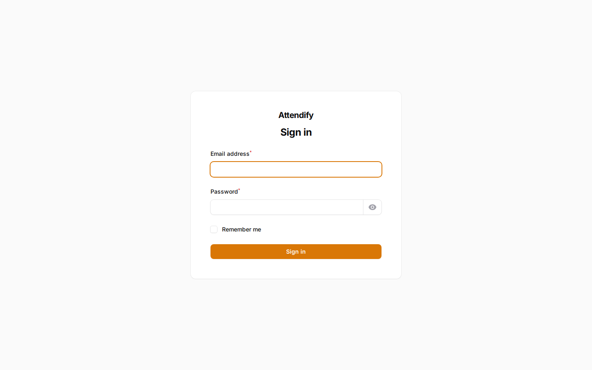
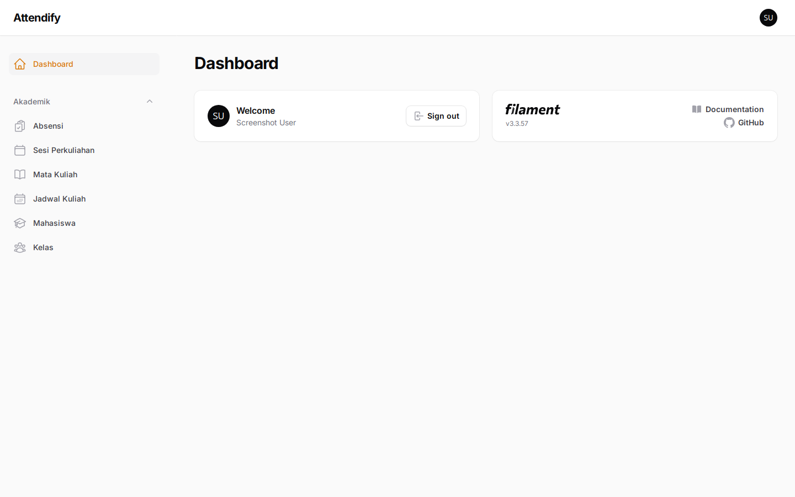
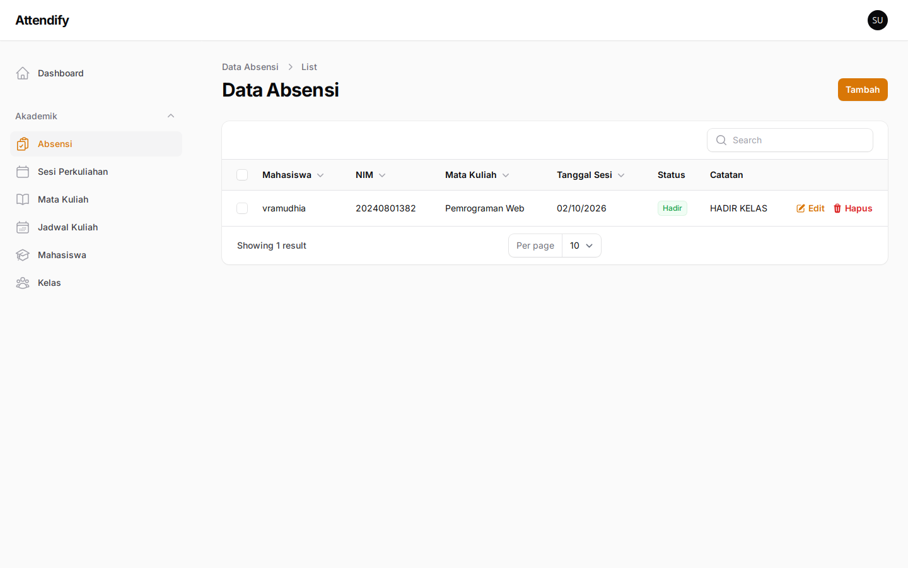
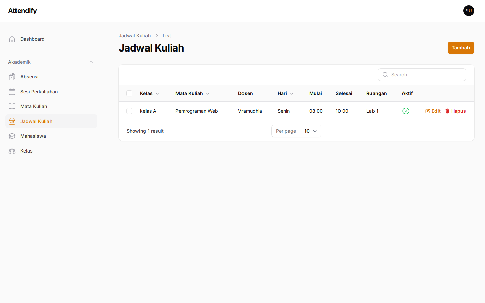
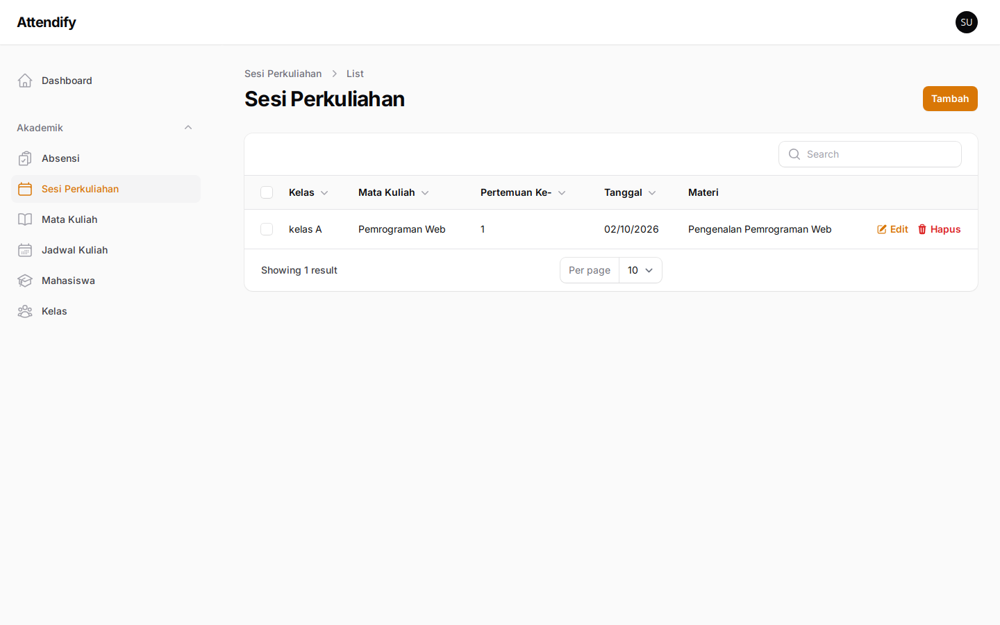
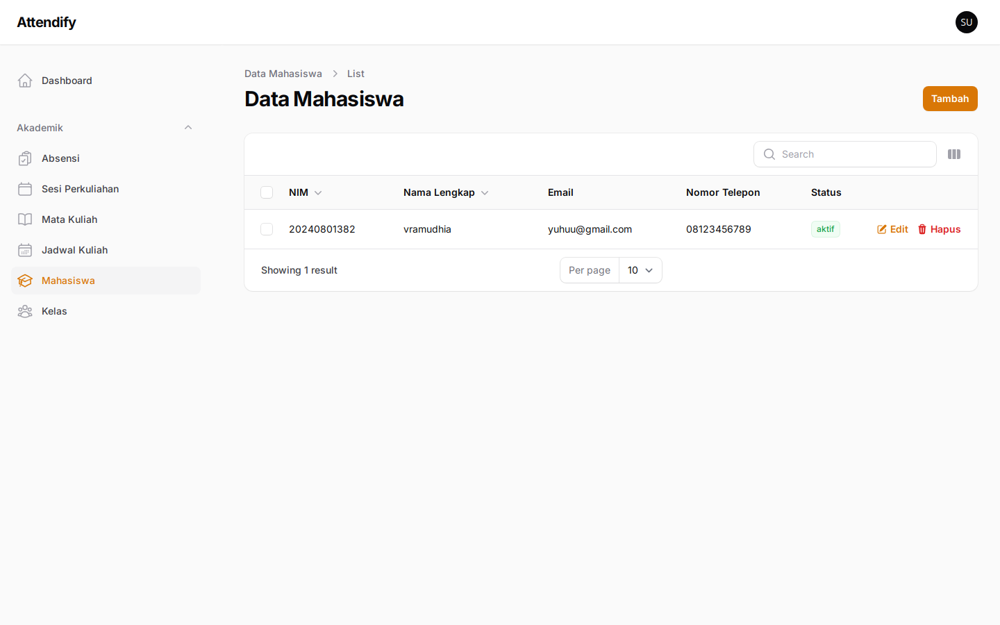

<h1 align="center">Attendify</h1>

<p align="center">
  Aplikasi absensi perkuliahan berbasis <strong>Laravel 12</strong> dan <strong>Filament v3</strong>.
</p>

<p align="center">
  <a href="https://laravel.com"></a>
  <a href="https://filamentphp.com"></a>
  <a href="https://mariadb.org"></a>
  <a href="https://www.docker.com"></a>
  
</p>

---

## Tentang

Attendify adalah aplikasi sederhana untuk mengelola kegiatan perkuliahan dan absensi mahasiswa:
mulai dari data kelas, mata kuliah, jadwal, sesi perkuliahan, mahasiswa, hingga pencatatan absensi
per mahasiswa pada setiap sesi.

Antarmuka admin dibangun sepenuhnya dengan **Filament v3** (CRUD, tabel, filter, dan form) sehingga
fokus aplikasi tetap pada data, bukan pada penulisan UI berulang.

## Fitur Utama

| Modul | Keterangan |
|---|---|
| **Kelas (Study Classes)** | Kelas/rombongan belajar: kode, nama, tahun akademik, semester, wali kelas |
| **Mata Kuliah (Courses)** | Daftar mata kuliah beserta kode, SKS, dan deskripsi |
| **Jadwal Kuliah (Course Schedules)** | Hubungan kelas × mata kuliah: dosen, hari, jam, ruangan |
| **Sesi Perkuliahan (Class Sessions)** | Daftar pertemuan per jadwal: nomor pertemuan, tanggal, materi |
| **Mahasiswa (Students)** | Data mahasiswa: NIM, nama, email, telepon, status |
| **Absensi (Attendance)** | Status kehadiran (Hadir/Izin/Sakit/Alpa) per mahasiswa per sesi |

Hubungan antar data:

```
StudyClass ─┬─< CourseSchedule >─ Course
                 │
                 └─< ClassSession ─< Attendance >─ Student
```

- Satu jadwal menghubungkan satu kelas dengan satu mata kuliah.
- Setiap jadwal memiliki sejumlah sesi pertemuan (nomor pertemuan unik per jadwal).
- Absensi unik untuk pasangan (sesi, mahasiswa) — tidak ada data ganda.
- Penghapusan dibatasi relasi: data yang sudah dirujuk tidak bisa dihapus sembarangan (FK `RESTRICT`).

## Teknologi yang Digunakan

- **Laravel 12** (PHP 8.2+ / diuji dengan PHP 8.4)
- **Filament v3.3** + **Livewire 3** — panel admin & CRUD
- **MariaDB 11.4** — basis data (session, cache, dan queue memakai driver `database`)
- **Docker Compose** — Nginx 1.28 + PHP-FPM 8.4
- **Vite + Tailwind CSS 4** — aset front-end (opsional untuk pengembangan)
- **PHPUnit** — pengujian otomatis

## Persyaratan

- [Docker](https://www.docker.com/) dengan Docker Compose v2
- (Opsional) Node.js 20+ jika ingin mengembangkan aset front-end

## Menjalankan dengan Docker

```bash
# 1. Salin template environment
cp .env.example .env

# 2. (Opsional) ganti DB_PASSWORD dan DB_ROOT_PASSWORD di dalam .env

# 3. Build dan jalankan kontainer
docker compose up -d --build

# 4. Install dependensi PHP di dalam kontainer
docker exec attendify_app composer install

# 5. Buat APP_KEY dan jalankan migrasi + seeder
docker exec attendify_app php artisan key:generate
docker exec attendify_app php artisan migrate --force
docker exec attendify_app php artisan db:seed
```

Aplikasi sekarang berjalan di **http://localhost:8080**.

> Nginx hanya mem-publish port di `127.0.0.1` (localhost). Untuk mengakses dari perangkat lain,
> ubah baris ports pada `compose.yaml` menjadi `"8080:80"`.

### Perintah yang sering dipakai

```bash
# Status migrasi
docker exec attendify_app php artisan migrate:status

# Menjalankan seluruh test (PHPUnit, database in-memory)
docker exec -w /var/www/html attendify_app php artisan test

# Masuk ke Tinker
docker exec -w /var/www/html attendify_app php artisan tinker

# Lihat log aplikasi
docker exec attendify_app tail -f storage/logs/laravel.log

# Hentikan kontainer (data database tetap tersimpan di volume)
docker compose down
```

## Mengakses Filament Admin

Buka **http://localhost:8080/admin** (root URL `/` juga akan diarahkan ke halaman ini).

Setelah `php artisan db:seed`, gunakan akun bawaan:

| Field | Value |
|---|---|
| Email | `test@example.com` |
| Password | `password` |

> Ganti password tersebut sebelum dipakai di lingkungan nyata.
> Cara membuat akun admin lain: `php artisan make:filament-user`.

## Screenshot

### Halaman Login



### Dashboard



### Data Absensi



### Jadwal Kuliah



### Sesi Perkuliahan



### Data Mahasiswa



## Struktur Proyek

```
attendify/
├── app/
│   ├── Filament/Resources/      # 6 resource CRUD Filament
│   ├── Models/                  # Eloquent model + relasi
│   └── Providers/               # AppServiceProvider & AdminPanelProvider
├── database/
│   ├── migrations/              # Skema database (relasi & constraint)
│   └── seeders/                 # Seeder akun admin
├── docker/                      # Dockerfile PHP-FPM & konfigurasi Nginx
├── docs/screenshots/            # Screenshot untuk README
├── routes/                      # Route web (redirect ke /admin)
├── tests/                       # Test CRUD absensi & validasi unik
├── compose.yaml                 # Orkestrasi Docker (app, nginx, mariadb)
└── .env.example                 # Template environment
```

## Pengujian

```bash
docker exec -w /var/www/html attendify_app php artisan test
```

Test yang tersedia:

- CRUD absensi (list, create, edit, delete, tolak data ganda)
- Validasi unik kode mata kuliah, kode kelas, dan nomor pertemuan
- Root URL diarahkan ke panel admin

## Lisensi

MIT — lihat `composer.json`.
